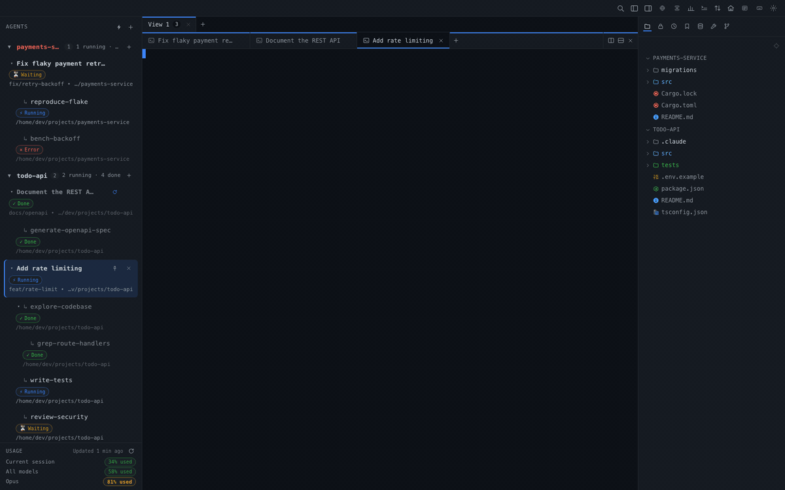
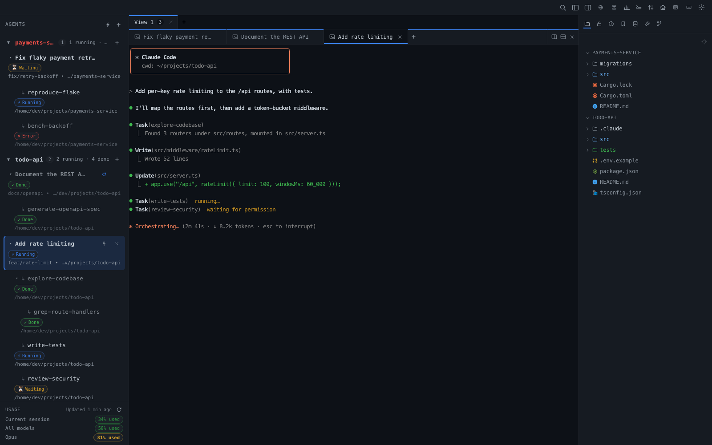
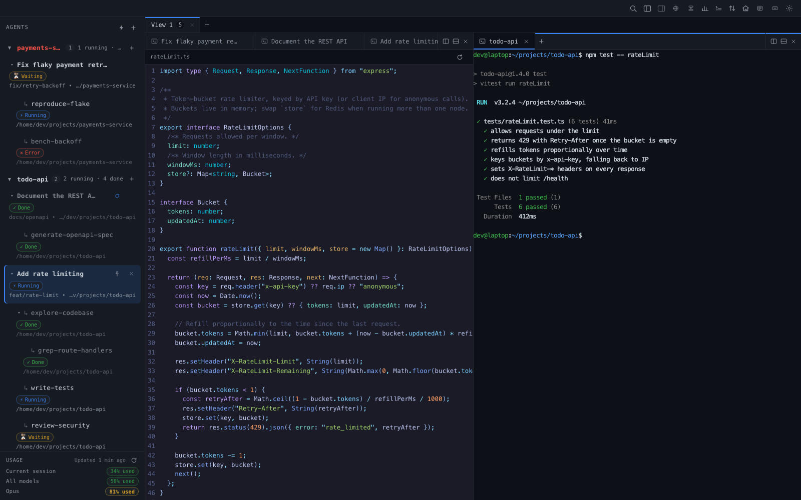
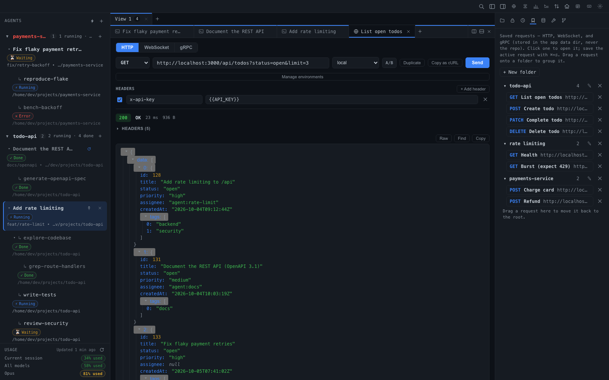
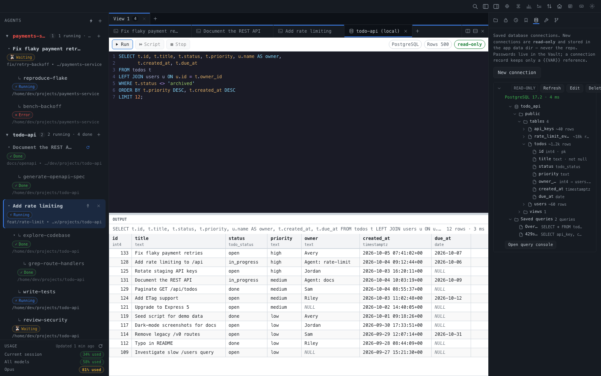
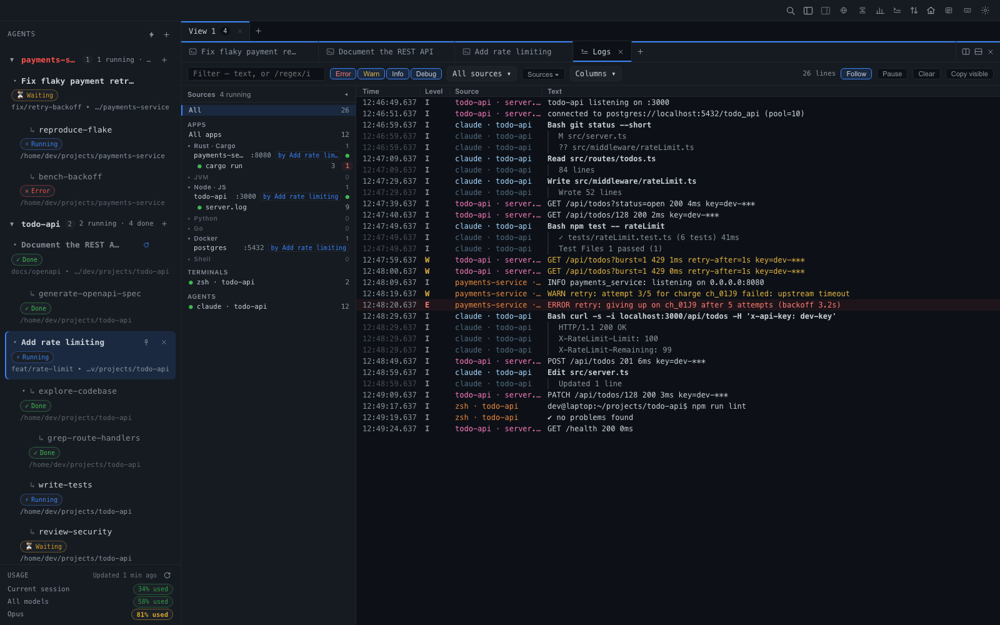
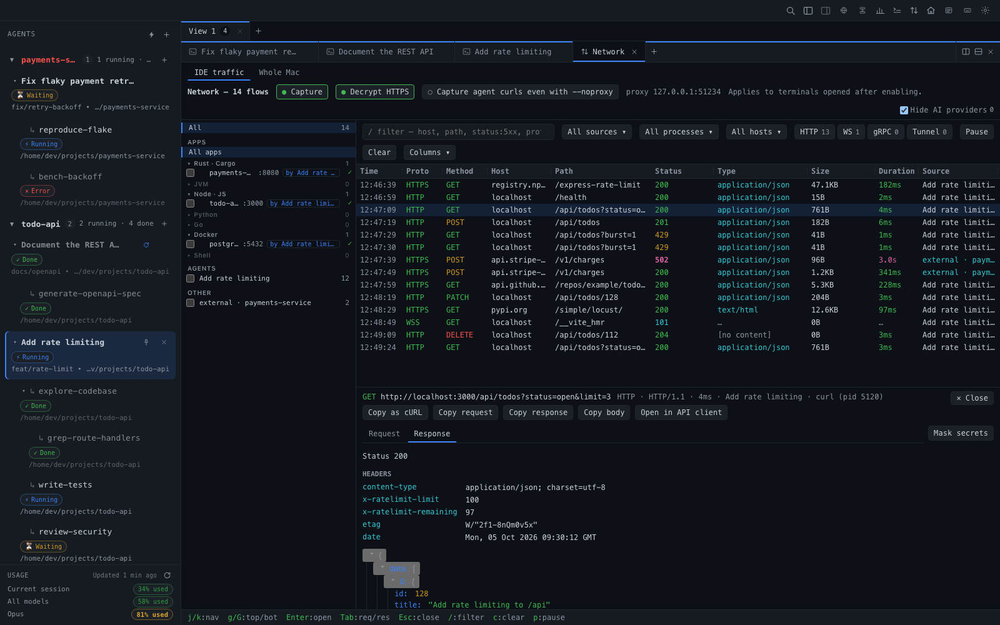
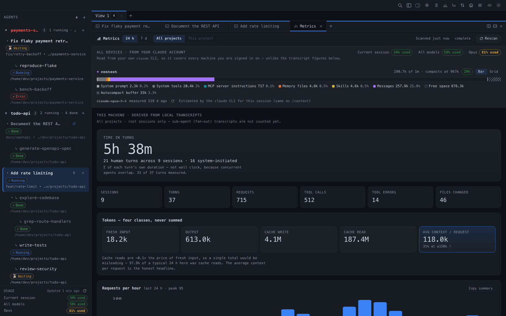

<h1 align="center">⚡ Agent Studio</h1>

<p align="center">
  <b>A native desktop cockpit for running many AI coding agents at once.</b><br>
  Real terminals, a live tree of every agent and the sub-agents it spawns, and the tools those
  agents need — editor, API client, database client, logs and network inspector — in one window.
</p>

<p align="center">
  
  
  
  
  
  
  
</p>

<p align="center">
  
</p>

## Why

Running one AI coding agent is easy. Running ten — each spawning sub-agents, on different branches,
starting dev servers and calling APIs — turns into a pile of terminal windows. You lose track of
which agent is doing what, which one is stuck waiting for you, and what it just ran.

Agent Studio shows the fleet as what it is: a **tree**. Each agent, the sub-agents it spawned, and
their status, live. Select any node and the terminal, files and branch follow it. An agent that
needs you raises a badge through every parent, so you see it even when the tree is collapsed.

<p align="center">
  
</p>

## What is inside

| | |
|---|---|
| <br><b>Terminals and editor</b> — real PTYs, split panes, tabs and saved views; a CodeMirror editor with highlighting for 100+ languages, git blame, go-to-definition and previews for Markdown, CSV, HTML and images. | <br><b>API client</b> — HTTP, WebSocket and gRPC; paste a curl command, <code>{{VAR}}</code> environments, collections, history and side-by-side response compare. |
| <br><b>Database client</b> — PostgreSQL, MySQL, ClickHouse, MongoDB, Redis, Valkey and DynamoDB; read-only by default, schema tree, query console and results grid. | <br><b>Agent Logs</b> — every command your agents run, the background services they start, and the dev apps running on your machine, in one filterable stream. |
| <br><b>Network</b> — a built-in capture proxy shows every HTTP, HTTPS, gRPC and WebSocket call made from an IDE terminal, with headers and bodies; one checkbox hides the agent CLIs' own traffic to AI providers, and a second view lists every app's connections on the machine. | <br><b>Metrics</b> — the context window of the selected agent, usage limits, and a dashboard of time, tool calls and tokens from your local transcripts. |

### Features

✅ works today · 🟡 in progress

| Feature | Support |
|---|---|
| **Agents** | ✅ **Claude Code** (`claude` CLI): launch in a real terminal, live tree of every agent and its sub-agents, running / waiting / done / error status, a badge that climbs to the root when one needs you<br>✅ Agents survive a restart with their session resumed; any past session from the session picker<br>✅ Outside agents: `claude` sessions started outside the IDE are detected and shown<br>✅ Context window of the selected agent, usage limits, metrics dashboard (time, tool calls, tokens)<br>🟡 **OpenAI Codex CLI**<br>🟡 **Local models** (Ollama) |
| **Languages** | ✅ Syntax highlighting for 100+ languages, with language detection and file-type icons<br>✅ Go to definition and find usages: Rust, TypeScript / JavaScript, Python, Go, C / C++, Java, Kotlin (through each language's server)<br>✅ Git blame in the editor<br>🟡 Completion and diagnostics |
| **Files it opens** | ✅ Any text or source file in the editor; undo that survives saving and closing the tab; reload when the file changes on disk<br>✅ Markdown rendered, Mermaid diagrams included, with its source a click away, zoom, pan and search<br>✅ CSV / TSV as a table<br>✅ HTML as a live page, or opened in your browser<br>✅ Images: PNG, JPEG, GIF, WebP, BMP, ICO, AVIF; SVG as a picture or its source |
| **Grid: panes, tabs and views** | ✅ New terminal, editor, request and database tabs in any pane<br>✅ Split right or down, or drop a tab on a pane edge; resize every split<br>✅ Drag a tab to another pane, or move it to another view<br>✅ Views: a tab that holds a whole layout of panes; create, rename and close them (their tabs move to another view)<br>✅ Tear a tab off into its own window, and move it back to the main window |
| **Terminals** | ✅ Real PTYs with a GPU renderer, clickable links and find<br>✅ A warning before closing a terminal that is still busy |
| **Search** | ✅ Find in files across the workspace (`.env` files included)<br>✅ Quick open by file name<br>✅ Find in the current file, terminal, Markdown preview or log<br>✅ Scoped to the workspace of the focused tab |
| **Logs** | ✅ One stream: agent tool calls and their results, background tasks agents start, and system logs (macOS log stream, journald, Windows Event Log)<br>✅ Dev apps running on your machine, grouped by runtime: Rust · Cargo, JVM, Node · JS, Python, Go, Docker, Shell; each with its log files and a Restart<br>✅ Level detection: tracing, env_logger, log4rs, slog, zerolog, logfmt, JSON loggers, Python logging, macOS os_log<br>✅ Level filters, find, column layout, sources sidebar with per-source counts |
| **Network traffic** | ✅ Built-in capture proxy: every HTTP, HTTPS, WebSocket and gRPC call from an IDE terminal, with headers and bodies<br>✅ HTTPS decryption on request (a local CA trusted only by IDE terminals); an agent's `curl --noproxy` is captured anyway<br>✅ Filter language (`status:5xx`, `proto:grpc`, `host:api`…), protocol chips, source / process / host pickers<br>✅ One checkbox hides the agent CLIs' own traffic to AI providers<br>✅ Copy a flow as curl or as raw request / response, open it in the request client, mask secrets on screen<br>✅ Whole-machine view: every app's open connections, with no permission prompt<br>🟡 Per-connection byte counts on Windows |
| **Requests** | ✅ HTTP, WebSocket, gRPC (with server reflection)<br>✅ Import a curl command; copy any request as curl for your shell<br>✅ Environments with `{{VAR}}` variables and a vault for secrets; collections; grouped, searchable history<br>✅ Sequences that pass values from one response into the next request<br>✅ Side-by-side response compare; JSON body editor; searchable, sortable JSON response view |
| **Databases** | ✅ PostgreSQL, MySQL, ClickHouse, MongoDB (SQL queries translated to MongoDB), Redis, Valkey, DynamoDB<br>✅ Read-only by default; schema tree you can reorder; query console with saved queries; results grid |
| **Git and workspace** | ✅ Multi-root file tree with git status colours<br>✅ Git tab: status, diff, revert, branches; your open GitHub pull requests<br>✅ Export and import of connections, requests and environments |
| **Shortcuts** | ✅ `⌘⇧F` find in files · `⌘O` quick open · `⌘F` find · `F12` go to definition · `⌘S` save · `⌘W` close tab · `⌘/` all shortcuts ([full list](#keyboard-shortcuts)) |
| **Extras** | ✅ Timestamp converter (epoch, ISO and plain dates)<br>✅ Agent Village: the fleet drawn as a living town, with outside agents and machine capacity |
| **Platforms** | ✅ macOS, Linux, Windows<br>🟡 Code signing and auto-update |

The images above are the real UI rendered with a scripted backend and fictional sample projects,
so they contain no real data. Regenerate them with `node scripts/readme-media.mjs`.

**Agent Studio never writes to `~/.claude`.** Hooks go only into a project's own
`.claude/settings.local.json`, and Claude's transcripts are read, never modified.

## Supported agents

| Agent | What works |
|---|---|
| **Claude Code** (`claude` CLI) | Launch, live status, sub-agent tree, session resume, usage limits, metrics |

Agents plug in through one `AgentAdapter` interface; the next ones are on the [roadmap](#roadmap).

## Install

**Prebuilt installers** for macOS, Windows and Linux are attached to
[GitHub Releases](https://github.com/DanZunder91/AgentStudioIDE/releases). They are unsigned for now: on
macOS, right-click the app and choose **Open** the first time.

**Build from source.** You need Rust (stable), Node 22 or newer, and the `claude` CLI, plus:

- macOS: Xcode Command Line Tools
- Linux (Debian/Ubuntu): `libwebkit2gtk-4.1-dev build-essential curl wget file libxdo-dev libssl-dev libayatana-appindicator3-dev librsvg2-dev patchelf`
- Windows: Microsoft C++ Build Tools and WebView2; on ARM64 also LLVM (clang), which `ring` needs

```bash
npm install
npm run tauri dev       # run the app
npm run tauri build     # build installers into src-tauri/target/release/bundle/
```

## Keyboard shortcuts

`⌘` on macOS, `Ctrl` on Windows and Linux. The full list is in the app: **`⌘/Ctrl + /`**.

| Keys | Action |
|---|---|
| `⌘ Shift F` | Find in files |
| `⌘ Shift O` or `⌘ O` | Quick open a file by name |
| `⌘ F` | Find in the current file, terminal or Markdown preview (find in files elsewhere) |
| `F3` / `Shift F3` | Next / previous match |
| `⌘ Click` | Go to definition (on a declaration: find its usages) |
| `F12` / `Shift F12` | Go to definition / find usages at the cursor |
| `⌘ S` | Save the file, the API request or the database query that has focus |
| `⌘ Z` / `⌘ Shift Z` (`Ctrl Y`) | Undo / redo |
| `F2` | Rename the focused view |
| `⌘ Enter` / `⌘ Shift Enter` | Database console: run the statement / the whole buffer |
| `⌘ Scroll` / `⌘ Drag` | Markdown preview: zoom / pan |
| `⌘ W` | Close the active tab |
| Drag a tab to a pane edge | Split the pane |
| `Esc` | Close a panel or dialog |
| `⌘ /` | Show all shortcuts |

**Network view:** `j` / `k` move, `g` / `G` top / bottom, `Enter` open a flow, `Tab` request / response,
`/` filter, `c` clear, `p` pause, `Esc` close.

## Roadmap

Alpha. Everything marked ✅ above works today on macOS, Linux and Windows; every merge to `main` publishes
installers to GitHub Releases.

**What is left**

- [ ] **Next iteration: more agents** — OpenAI (Codex CLI) and local models through Ollama, behind
      the same `AgentAdapter` interface: launch, live status, sub-agent tree and metrics, as Claude
      Code has today
- [ ] **Code signing and auto-update** — installers are unsigned today (on macOS, right-click the
      app and choose **Open** the first time)
- [ ] **Code intelligence** — completion and diagnostics; today it is go-to-definition and find
      usages
- [ ] **Windows network bytes** — the whole-machine network view has no per-connection byte counts
      on Windows, because the OS does not expose them

## How it is built

| Layer | Choice |
|---|---|
| Shell | Tauri v2 |
| Core | Rust (tokio, `portable-pty`, reqwest + rustls, sqlx, tonic, libgit2, ripgrep) |
| UI | TypeScript + React 19 |
| Terminal | xterm.js |
| Editor | CodeMirror 6 + Shiki |

Agents run in real terminals, and the tree is rebuilt from Claude Code's own telemetry
(transcripts and hooks). Terminal output goes straight from the PTY to the terminal emulator and
never passes through React state, so a noisy agent cannot stall the UI.

One command runs every quality gate locally — type check, lint, unit and browser tests with
coverage, Rust format/lint/tests, dependency audit, integration tests against Docker databases, and
end-to-end tests of the real app:

```bash
npm run verify
```

## Documentation

| Doc | What is inside |
|---|---|
| [`docs/design/ARCHITECTURE.md`](docs/design/ARCHITECTURE.md) | The architecture: data model, Rust modules, IPC, the fan-out tree |
| [`docs/design/testing-strategy.md`](docs/design/testing-strategy.md) | How it is tested: the test pyramid, coverage floors, fixtures |
| [`docs/design/e2e-flow-catalog.md`](docs/design/e2e-flow-catalog.md) | The end-to-end flows and the seams that make them deterministic |
| [`docs/design/csp.md`](docs/design/csp.md) | The webview's Content-Security-Policy, directive by directive |
| [`docs/design/language-detection.md`](docs/design/language-detection.md) | How a file's language is decided |
| [`docs/design/editor-syntax-highlighting.md`](docs/design/editor-syntax-highlighting.md) | The editor's highlighting engine |
| [`docs/design/code-intelligence.md`](docs/design/code-intelligence.md) | Go-to-definition and find usages over LSP |
| [`docs/design/file-icons.md`](docs/design/file-icons.md) | The file-type icon system |
| [`docs/design/sql-to-mongo.md`](docs/design/sql-to-mongo.md) | SQL queries translated to MongoDB |
| [`docs/design/tab-tearoff.md`](docs/design/tab-tearoff.md) | Moving a tab into its own window |
| [`docs/design/agent-restart-restore.md`](docs/design/agent-restart-restore.md) | How agents come back after a restart |
| [`e2e/README.md`](e2e/README.md) | Running the end-to-end suite in Docker |
| [`docker/db-fixtures/README.md`](docker/db-fixtures/README.md) | The local databases the database client is tested against |

## Licence

Agent Studio is licensed under the [GNU Affero General Public License v3.0](LICENSE) (AGPL-3.0-only).
You may use, modify and redistribute it, but if you distribute a modified version or offer one as a
network service, you must publish your source code under the same licence.

If you want to use Agent Studio in a product without those obligations, a commercial licence is
available from the author. Third-party components keep their own licences; see
[`THIRD-PARTY-NOTICES.txt`](THIRD-PARTY-NOTICES.txt).

Copyright © 2026 Dan Zunder.
